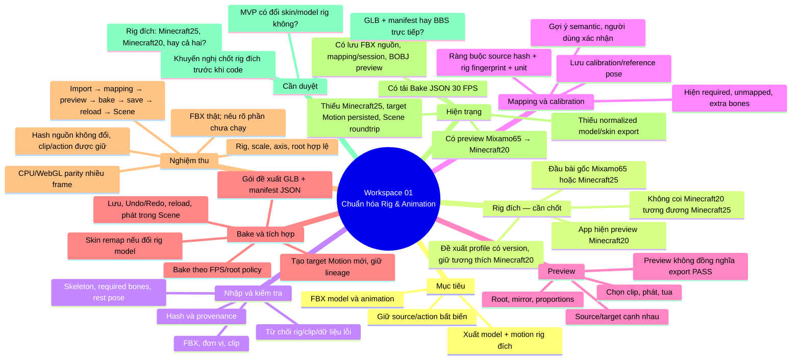

# Workspace 01 — Chuẩn hóa Rig & Animation

**Bản đề xuất để duyệt; chưa triển khai code.**

## Phương án đề xuất

Giữ source bất biến; cho project chọn rig đích theo profile có version. Tái sử dụng importer, solver, mapping/calibration và preview hiện có. Kết quả bake phải được lưu thành Motion đích mới trong project, có provenance, chạy được ở Scene sau reload. Nếu đầu ra yêu cầu model đã đổi skeleton, cần thêm skin-weight remap và kiểm tra bind pose; không được gọi clip JSON tải về là model/animation đã chuẩn hóa.

## Điểm cần duyệt trước khi code

1. Chốt target rig: Minecraft25 theo đầu bài, Minecraft20 tương thích bản hiện tại, hay hỗ trợ cả hai.
2. Chốt MVP có bắt buộc chuyển skin/model sang rig đích hay chỉ cần animation trên rig đích.
3. Chốt gói trao đổi: GLB + manifest JSON hay export trực tiếp sang BBS FS.
